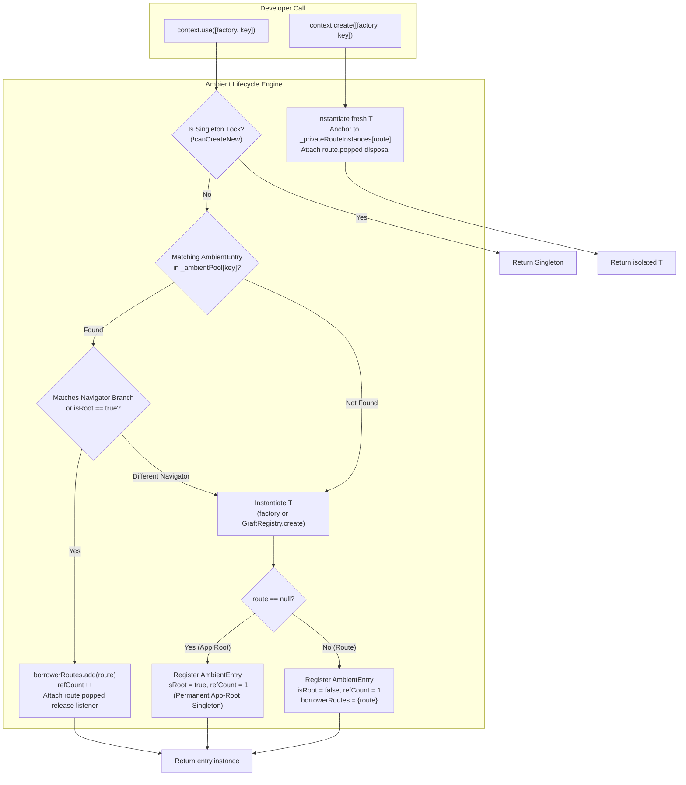

# Graft Architecture & Technical Reference Manual

---

## 🏛️ Executive Summary & Architectural Philosophy

**Graft** was engineered from first principles to resolve the fundamental architectural compromises inherent to modern Flutter state management and dependency injection frameworks:

1. **The Allocation Tax:** Traditional frameworks allocate heap memory on every state mutation (immutable copies, `copyWith()` trees, event wrappers, streams, and closures).
2. **The Selector Indirection Tax:** Micro-rebuild isolation typically requires manual selector functions (`select((s) => s.foo)`), introducing heap closures and registration overhead.
3. **The Global Service Locator Hazard:** Traditional service locators rely on runtime string keys or untracked singletons with no compile-time DAG cycle detection, resulting in memory leaks and teardown order bugs.
4. **The Blank-Frame Persistence Race:** Asynchronous persistence models force UI trees into loading spinners or blank frames while waiting for storage engines to initialize on Frame 0.
5. **The Wrapper Hell Tax:** Subtree scoping and dependency injection typically demand nesting widgets in endless wrappers (`Provider`, `MultiProvider`, `BlocProvider`, `GraftScope`).

Graft eliminates these trade-offs through a unified, 100% zero-wrapper runtime built on **7 Core Architectural Pillars**.

---

## 💎 The 7 Core Architectural Pillars

```text
┌──────────────────────────────────────────────────────────────────────────────────────────────────────────────┐
│                                          GRAFT RUNTIME ARCHITECTURE                                          │
├────────────────────────────────┬────────────────────────────────┬────────────────────────────────────────────┤
│  ⚡ Pillar 1: Bitmask Diffing  │  🎯 Pillar 2: Leaf Slot Engine │  🔢 Pillar 3: Monotonic TypeId             │
│  - In-place cascade mutation   │  - 0-rebuild leaf elements     │  - O(1) integer array lookup               │
│  - 64-bit SIMD word registers  │  - Direct pointer dispatch     │  - ≤ 12 ns cold / < 0.8 ns hot             │
│  - Zero heap allocation diffs  │  - Bypass selector closures    │  - Pure Dart AOT specialization            │
├────────────────────────────────┼────────────────────────────────┼────────────────────────────────────────────┤
│  🛡️ Pillar 4: Reverse DAG Drop │  ⏳ Pillar 5: Async Gate DI    │  💾 Pillar 6: Frame-0 Dry State            │
│  - In-degree topological sort  │  - Non-blocking bindAsync<T>   │  - Synchronous L1 RAM cache                │
│  - Consumers dispose first     │  - Frame-0 zero-crash auto-wait│  - 300ms coalescing debounce               │
│  - Circular dependency check   │  - Zero manual query wrappers  │  - Structural schema hash                  │
├────────────────────────────────┴────────────────────────────────┴────────────────────────────────────────────┤
│  🌐 Pillar 7: Ref-Counted Ambient Engine (Zero-Wrapper Architecture)                                         │
│  - 100% wrapper-free: No GraftScope or MultiProvider                                                         │
│  - Universal verbs: context.use<T>() (shared flow) vs context.create<T>() (isolated)                        │
│  - App-Root singleton auto-promotion (route == null -> isRoot = true)                                        │
│  - Set-based rebuild idempotency (prevents refCount ballooning)                                              │
│  - Multi-route ref-counted lifecycle with tombstone-deferred exit transition teardown                        │
└──────────────────────────────────────────────────────────────────────────────────────────────────────────────┘
```

---

### Pillar 1: Hardware-Aligned Bitmask Diffing

Rather than allocating immutable clones on every keystroke or event, `GraftState` uses native Dart cascade mutations on plain fields:

```dart
state
  ..customerName = 'Alice'
  ..notes = 'Urgent'
  ..update();
```

When `update()` executes, Graft compares the current values of `props` against an in-place baseline snapshot using bitwise shift operations (`w |= 1 << i`) across 64-bit integer words (`GraftMask`).

```text
┌────────────────────────────────────────────────────────────────────────┐
│                      DEVELOPER CALL (ZERO BOILERPLATE)                 │
│         state..address.city = 'Berlin'..tasks.add(item)..update()      │
└───────────────────────────────────┬────────────────────────────────────┘
                                    │
                                    ▼
┌────────────────────────────────────────────────────────────────────────┐
│                          GRAFT CORE ENGINE                             │
│                  diffChanges(): Evaluate props against _baseline       │
│                                   │                                    │
│         ┌─────────────────────────┼────────────────────────┐           │
│         ▼                         ▼                        ▼           │
│  [ Primitive Values ]   [ Nested Sub-States ]     [ Collections ]      │
│  (int, String, bool)    (GraftState in props)    (List, Set, Map)      │
│  1-Cycle Identity:      Deep Recursive Props     Recursive Elements    │
│  identical(prev, curr)  Snapshot Comparison      Snapshot Equality     │
│         │                         │                        │           │
│         └─────────────────────────┼────────────────────────┘           │
│                                   ▼                                    │
│            Compute 64-bit Integer dirtyMask in CPU registers           │
│                                   │                                    │
│                                   ▼                                    │
│                       notifyMask(dirtyMask)                            │
└────────────────────────────────────────────────────────────────────────┘
```

- **Zero Allocations:** No intermediate `Change` objects, no `copyWith` copies, no stream events.
- **Microsecond Latency:** Full diffing executes in $< 50\text{ ns}$ directly in CPU registers.
- **64-Bit Word Registers:** Up to 64 state fields are tracked in 64-bit integer bitmasks. Models with more than 64 fields scale dynamically into chunked 32-bit integer words with 100% web JavaScript compatibility.

---

### Pillar 2: Surgical Leaf Slot Isolation

Flutter's standard `setState` or coarse `AnimatedBuilder` marks entire subtrees dirty. Graft's `graft.slot()` and `graft.slots()` register direct C-level Element pointers (`GraftFastReceiver`):

- When a field bitmask changes, `GraftEngine.notifyMask()` marks **only the specific leaf Element dirty** in Flutter's build pipeline.
- Intermediate parent and sibling widgets experience **0 rebuilds**.
- Closures and selector evaluation trees are completely bypassed.

```text
┌────────────────────────────────────────────────────────────────────────┐
│              SELF-HEALING SLOT RECONCILIATION PIPELINE                 │
│                 GraftMultiChildDiffEngine / GraftBoundary              │
│                                   │                                    │
│            Does dirtyMask intersect slot's learnedDependencies?        │
│                    ┌──────────────┴──────────────┐                     │
│                   YES                            NO                    │
│                    │                             │                     │
│           [⚡ 1-CPU Fast Path]         [🔬 2-ns Fingerprint Check]     │
│           Immediate leaf rebuild       Evaluate slot hash              │
│           notifier.value = newWidget;            │                     │
│                                      ┌───────────┴───────────┐         │
│                                     MATCH                DIFFERENT     │
│                                      │                       │         │
│                                 [0 Rebuild]       [💥 SELF-HEAL MASK]  │
│                                 Bypassed clean    • Leaf rebuild!      │
│                                                   • learned |= dirty   │
└────────────────────────────────────────────────────────────────────────┘
```

- **Pre-Flight Slot Short-Circuiting:** `graft.slots(...)` tracks `ignoredMask` alongside learned dependencies. If a mutation only modifies fields that no child slot listens to, the diff engine bypasses the layout phase in 0 element rebuilds.
- **Depth-$N$ Parent Rebuild Insulation:** Leaf slots run inside an internal `NoSubscriptionContext`, preventing ambient `Theme` or `MediaQuery` subscriptions from leaking into parent layout widgets.

---

### Pillar 3: Monotonic Integer Type Identification (`TypeId`)

Traditional dependency injection frameworks key instances by `Type.toString()` strings or runtime hashes, requiring hash table bucket probing on every lookup:

- Graft assigns a **monotonic 32-bit integer** to each resolved type on first access via `TypeId.of<T>()`.
- Active scope nodes store instances in contiguous flat arrays (`List<Object?> _instances`).
- Hot lookups are direct index operations (`_instances[id]`):
  - **Cold Lookup:** $\le 12\text{ ns}$ (monotonically indexed registration).
  - **Hot Lookup:** $< 0.8\text{ ns}$ (hardware L1 CPU cache hit).

---

### Pillar 4: In-Degree Topological Reverse DAG Teardown

When a scope or feature unmounts, dependencies must be torn down strictly in **reverse creation order**:

- If `OrderService` depends on `DatabaseService`, `OrderService` must close its active transactions before `DatabaseService` disconnects.
- `ScopeNode` dynamically records dependency relationships during resolution.
- On `drop()`, an in-degree topological sort disposes consumers first and base dependencies last, guaranteeing zero dangling pointer crashes or leaked file descriptors.
- Circular dependency cycles are detected during resolution with descriptive DAG stack traces.

---

### Pillar 5: Self-Healing Non-Blocking Async Execution Gate

Async services (databases, key-value stores, secure storage, network clients) previously forced developers to either:
1. Block application boot with `await db.open()` in `main()`, delaying the first frame.
2. Manually subclass custom service wrappers and wrap every method in `guard(() => ...)`.

Graft introduces `bindAsync<T>()` and `useAsync<T>()`:
- Execution is lazy and non-blocking by default.
- If accessed on Frame 0 before initialization completes, `useAsync<T>()` transparently awaits the in-flight initialization.
- Once completed, subsequent accesses return the cached singleton in $0\text{ ns}$.
- Devs write 100% standard Dart classes with zero boilerplate wrappers.

---

### Pillar 6: Frame-0 Dry State & Coalescing Background Persistence

Hydrating persisted form states via asynchronous storage engines (SQLite, SharedPreferences) causes blank input fields or flickering UI on Frame 0:

- **Synchronous L1 RAM Cache:** Pre-warmed during bootstrap or lazy mount, providing state data in $< 50\text{ ns}$ during widget build.
- **Zero-Controller Forms:** Standard Flutter `TextFormField(initialValue: graft.state.customerName)` takes the Frame-0 restored state directly with ZERO controllers and ZERO `initState`.
- **Coalescing 300ms Background Queue:** Keystrokes update L1 RAM synchronously on every frame, while coalescing disk writes into a single debounced 300ms I/O operation.
- **Structural Schema Fingerprinting with `schemaVersion`:** Combines deterministic 32-bit FNV-1a hashing of `props` structure with `schemaVersion`. Stale caches are discarded safely across app updates with zero migration scripts.

---

### Pillar 7: Ref-Counted Ambient Engine (Zero-Wrapper Architecture)

With **Alpha 6**, Graft eliminates `GraftScope` and all widget wrappers. Controllers are resolved and managed through an ambient lifecycle engine:



#### The 2 Universal Verbs:
1. **`context.use<T>([factory, key])` ("Borrow or Create")**:
   - Checks the ambient pool for an existing instance of `T` belonging to the current navigation branch.
   - If present, borrows it and increments `refCount`.
   - If absent at the App Root (`route == null`), auto-promotes to a permanent singleton (`isRoot = true`).
   - If absent inside a screen (`route != null`), creates it and auto-disposes when all borrower routes pop (`refCount == 0`).
2. **`context.create<T>([factory, key])` ("Always Force New")**:
   - Instantiates a brand-new, isolated instance of `T`.
   - Bypasses the ambient pool entirely and anchors directly to the current route's private ownership list.
   - Disposed automatically when the owner route pops.

#### Automatic Engine Safeguards:
- **Set-Based Rebuild Idempotency:** `borrowerRoutes.add(effectiveRoute)` returns `true` only on the first call. 50 `setState` calls or animation frames on the same route will **never** inflate `refCount`.
- **Navigator Branch Ancestry:** Prevents horizontal state leaks across parallel tab navigators.
- **Tombstone-Deferred Teardown:** During 300ms route pop animations, controllers remain safe to read by unmounting widgets without throwing exceptions or resurrecting zombie instances.

---

## 📚 Technical Reference & Documentation Hub

- 🚀 **[graft_template](https://github.com/kmmuzahid/graft_template):** Production-ready starter template integrating Graft with CoreKit.
- 📘 **[DI Engine Guide](https://github.com/kmmuzahid/graft/blob/main/DI_GUIDE.md):** Enum scopes, async bindings, and singleton locks.
- 📙 **[State & Persistence Guide](https://github.com/kmmuzahid/graft/blob/main/GRAFT_GUIDE.md):** Cascade mutations, slot diffing, and Frame-0 Dry State.
- 📊 **[Empirical Benchmark Report](https://github.com/kmmuzahid/graft/blob/main/BENCHMARK_REPORT.md):** 21 empirical benchmark scenarios and hardware specs.
- 🧪 **[Test Verification Report](https://github.com/kmmuzahid/graft/blob/main/TEST_REPORT.md):** Comprehensive test verification matrix across the entire suite.
- 📋 **[Public API Cheat Sheet](https://github.com/kmmuzahid/graft/blob/main/README.md#-complete-public-api-cheat-sheet):** Every public API listed with practical 2–3 line usages.
