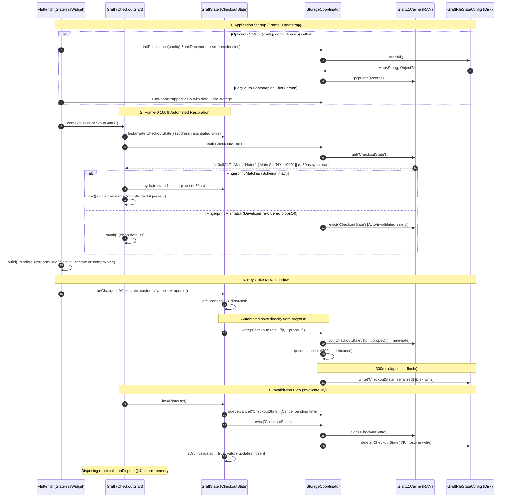

# Technical Architecture & Specification: Frame-0 Dry State, GraftModel Serialization & Persistence

---

## 1. Architectural Principles & File Placement

### 1.1 Strict Modular Constraints
1. **< 200 Lines Per Class Rule:** No single class, mixin, or engine component shall exceed **200 lines of code**. Large responsibilities are decomposed into single-purpose, highly decoupled classes.
2. **100% DRY Cascade-Mutable Models (Zero Boilerplate Standard):** 
   - Standardized on **Option B**: Domain models follow the exact same cascade-mutable paradigm as `GraftState`.
   - Developers write plain mutable variables (`String street = '';`) and `props => propsOf(...)`.
   - **Zero `fromTuple` mapping constructors.**
   - **Zero constructor tear-offs (`dryConstructor` is completely eliminated).**
   - **Zero `t.get()` calls.**
   - The model instance is created once by the developer during state instantiation (`AddressModel address = AddressModel();`). On Frame 0, Graft hydrates the existing instance directly in-place!
3. **Standardized "Dry" Terminology:** The entire persistence and Frame-0 hydration engine standardizes on the **"Dry"** concept:
   - `bool get enableDry => true` (boolean activation).
   - `dryKey` (storage identification).
   - `invalidateDry()` (cancel timers, evict L1, write tombstone, freeze future saves).
   - `ValueGraft.dry()` (standalone micro-state persistence).
4. **100% Optional Bootstrap (`Graft.init`) & Clean `setup` Parameter:** 
   - **`Graft.init()` is Completely Optional:** If omitted, Graft boots lazily on the first screen with default file storage—requiring **zero lines of setup in `main()`**.
   - **Optional Startup Configuration:** If developers want to supply a custom storage driver (e.g. encrypted or SQLite), configure dependency injection, or pre-warm L1 cache before `runApp()`, they can call:
     ```dart
     Graft.init(config: CustomStorageConfig(), setup: configureDependencies);
     ```
   - **Zero Internal Plumbing Exposed:** Engine primitives (`GraftL1Cache`, `GraftDebounceQueue`, `GraftStorageCoordinator`) are **never exposed to or registered in DI**.
5. **100% Automatic Saving from `propsOf`:** Graft automatically extracts and serializes domain properties directly from `propsOf` for both `GraftState` and `GraftModel`—developers write **zero saving code**.
6. **100% Automatic Schema Fingerprinting (Zero Manual Versioning):** Graft automatically computes a structural type-and-length hash of `propsOf`. If a developer re-orders properties, changes types, or adds/removes fields in future code, Graft detects the fingerprint mismatch automatically and safely discards stale data—**developers never manage manual version integers**.
7. **No Binders Needed — Native Lifecycle (`onInit` / `onDispose`) & `TextFormField.initialValue`:**
   - **Zero Binders & Zero Subscriptions:** External binder extensions (`bindGraft`, `GraftControllerSubscription`, sync engines) are completely eliminated.
   - **Zero-Controller Forms:** Standard Flutter `TextFormField(initialValue: graft.state.customerName)` takes the Frame-0 restored state directly with ZERO controllers, ZERO `initState`, and ZERO `dispose` in pure `StatelessWidget`s.
   - **Native Lifecycle Hooks:** When explicit controllers are needed (e.g. for focus nodes, selection, or input masks), `Graft` provides `onInit()` and `onDispose()`. `onInit()` runs immediately after Frame-0 hydration to set `controller.text = state.customerName`, and `onDispose()` automatically disposes them when the route pops.
8. **Dry Invalidation & Freeze (`invalidateDry()` at State or Scope Level):**
   - **State-Level:** Calling `graft.invalidateDry()` permanently deactivates persistence for that specific state.
   - **Scope-Level (Flow-Wide):** Calling `AppScope.checkout.invalidateDry()` (via developer's `enum AppScope`) purges all persisted dry forms and states across the entire multi-screen flow with a single line of code! Cancels pending debounce writes, evicts L1, writes L2 tombstones, and freezes future saves.
9. **Pure Dart Core:** Background isolates, CLI tools, and unit tests run without Flutter platform-channel dependencies.

---

### 1.2 Sub-Module Directory Layout

The persistence engine is organized into 4 decoupled sub-domains within `lib/src/persistence/` plus native lifecycle hooks in `lib/src/core/`:

```
lib/
├── graft.dart                                    # Public exports
└── src/
    ├── core/
    │   └── graft.dart                           # Base Graft with optional Graft.init(), onInit(), and onDispose()
    └── persistence/
        ├── config/                               # 📁 Storage SPI & Configs (Only GraftStateConfig exposed)
        │   ├── state_config.dart                # Single user-facing SPI contract (< 50 lines)
        │   ├── memory_state_config.dart         # Pure in-memory config driver (< 60 lines)
        │   └── file_state_config.dart           # Automatic default file I/O driver (< 120 lines)
        ├── coordinator/                          # 📁 Internal Orchestration (Completely hidden from DI)
        │   ├── l1_cache.dart                    # Internal synchronous in-memory hash cache (< 80 lines)
        │   ├── debounce_queue.dart              # Internal coalescing timer write buffer (< 95 lines)
        │   ├── storage_coordinator.dart         # Internal coordinator facade (< 130 lines)
        │   └── ambient_locator.dart             # Internal automatic resolver & fallback (< 65 lines)
        ├── model/                                # 📁 Tier-2 Model Serialization & Hydration
        │   ├── graft_model.dart                 # Tier-2 100% DRY base contract (< 35 lines)
        │   └── tuple_serializer.dart            # Recursive tuple transformation (< 85 lines)
        └── dry/                                  # 📁 State Dry & Fingerprinting Engine
            ├── schema_fingerprint.dart          # Automatic type/length structural hasher (< 55 lines)
            ├── dry_expando.dart                 # GC-safe Expando lifecycle manager (< 45 lines)
            ├── dry_state_hook.dart              # Ingestion hook, invalidateDry & update (< 115 lines)
            └── dry_value_graft.dart             # ValueGraft.dry() helper (< 70 lines)
```

---

## 2. Public API Surface & Component Specifications (< 200 Lines Each)

### 2.1 State Config & Drivers (`lib/src/persistence/config/`)

#### `state_config.dart` (< 50 lines) — The *Only* Interface Ever Exposed to DI
Abstract Service Provider Interface (SPI). This is the **only class a developer ever binds in DI**, and only if they want a non-default driver.
```dart
abstract interface class GraftStateConfig {
  Future<void> init();
  Future<Map<String, Object?>> readAll();
  Future<void> write(String key, Object? value);
  Future<void> delete(String key);
  Future<void> flush();
  Future<void> clear();
}
```

#### `file_state_config.dart` (< 120 lines) — Automatic Default
Pure Dart (`dart:io`) JSON/atomic binary file storage driver.
- If DI has no registered `GraftStateConfig`, Graft **automatically instantiates and initializes `GraftFileStateConfig` by default**.
- Zero lines of configuration required from the developer.

#### `memory_state_config.dart` (< 60 lines)
In-memory implementation for isolated unit tests, benchmarks, and CLI runners.

---

### 2.2 Coordinator & Caching (`lib/src/persistence/coordinator/`)
> **Internal Architecture Rule:** All classes in this directory are marked `@internal`. They are created, wired, and warmed up automatically by the engine. Never exposed to user DI.

#### `ambient_locator.dart` (< 65 lines)
Pure Dart ambient resolver that automatically wires persistence:
1. Checks if a custom `GraftStateConfig` was provided via `Graft.init(config: ...)` or DI.
2. If none is found, automatically falls back to default `GraftFileStateConfig`.
3. Lazily creates and holds the internal `GraftStorageCoordinator` singleton on demand.
4. Developers **never manually register or request the coordinator**.

#### `l1_cache.dart` (< 80 lines)
Internal synchronous in-memory read/write cache backed by a standard Dart `Map<String, Object?>`. Provides guaranteed $O(1)$ sub-microsecond access required for Frame-0 synchronous constructor hydration.

#### `debounce_queue.dart` (< 95 lines)
Internal timer scheduling and write coalescing.
- Buffers rapid mutations (e.g. typing at 100 WPM) into a single disk I/O operation.
- Default flush window: **300ms**.
- Supports immediate synchronous `cancel(key)` when `invalidateDry()` is invoked.
- Supports immediate synchronous `flush()` on app lifecycle pause or route destruction.

#### `storage_coordinator.dart` (< 130 lines)
The internal persistence facade orchestrating the L1 cache, debounce queue, and active `GraftStateConfig`.

---

### 2.3 Model Serialization & In-Place Hydration (`lib/src/persistence/model/`)

#### `graft_model.dart` (< 35 lines) — 100% DRY Base Contract
Base class for Tier-2 nested entities.
- Enforces flat `props` contract for reactive diffing and automatic serialization.
- Follows the exact same cascade-mutable pattern as `GraftState`.
- **Zero `fromTuple` mapping constructors.**
- **Zero constructor tear-offs.**
- **Zero `t.get()` calls.**
```dart
abstract class GraftModel {
  const GraftModel();

  /// Flat domain properties tuple contract.
  GraftProps get props;
}
```

#### `tuple_serializer.dart` (< 85 lines)
Pure static serializer recursively transforming primitives, `GraftModel` entities, and standard Dart collections into nested JSON-safe tuples (`List<Object?>`) via `model.props`. Zero configuration required.

---

### 2.4 State Dry, Fingerprinting & Invalidation (`lib/src/persistence/dry/`)

#### `schema_fingerprint.dart` (< 55 lines)
Automatically computes a 32-bit structural fingerprint from `propsOf` based on length and runtime types.
- **⚡ Benchmark Preservation Invariant:** Computed **ONCE on Frame-0 initialization and cached** in memory. It is **never** re-computed during active `update()` frame diffs, adding $0\text{ ns}$ overhead to keystroke mutations!
```dart
class SchemaFingerprint {
  @pragma('vm:prefer-inline')
  static int compute(GraftProps props) {
    final len = props.length;
    int hash = len;
    for (int i = 0; i < len; i++) {
      hash = Object.hash(hash, props[i].runtimeType);
    }
    return hash;
  }
}
```
If a developer re-orders properties, changes types, or adds/removes fields in future code, the initial fingerprint comparison automatically mismatches, causing Graft to safely discard stale incompatible data with zero manual version numbers.

#### `dry_state_hook.dart` (< 115 lines)
Engine hooks integrated directly into `GraftState` and `Graft<S>`:
- **Boolean Activation:** Developer simply overrides `bool get enableDry => true;`.
- **Zero-Diff Regression:** If `enableDry == false`, `update()` performs a single boolean check ($\sim 0.2\text{ ns}$), strictly maintaining the $< 50\text{ ns}$ diff benchmark.
- **Automatic Saving:** On `update()`, if `enableDry` is true and not invalidated, Graft pushes `props` paired with the cached `_schemaFingerprint` into `GraftL1Cache` ($\sim 15\text{ ns}$) and resets the coalescing 300ms background write timer.
- **`invalidateDry()` Engine:** Cancels pending debounce writes, evicts L1, writes an L2 tombstone, freezes future saves, and guarantees clean memory on dispose.

```dart
abstract class GraftState {
  ...
  /// Override to true to enable Frame-0 dry state persistence with zero boilerplate.
  bool get enableDry => false;

  /// Unique storage identifier for this state (defaults to runtimeType.toString()).
  String get dryKey => runtimeType.toString();

  /// Permanently deactivates and invalidates dry state persistence for this session.
  void invalidateDry();
}

extension GraftPersistenceX<S extends GraftState> on Graft<S> {
  /// Calls [state.invalidateDry()] to permanently deactivate dry state persistence.
  void invalidateDry() => state.invalidateDry();
}
```

---

### 2.5 Native Graft Lifecycle Hooks & Startup (`lib/src/core/graft.dart`)

```dart
abstract class Graft<S extends GraftState> extends ChangeNotifier {
  /// OPTIONAL application entry point in main():
  /// Only needed if you want custom [config] or custom [setup].
  /// If omitted, Graft automatically boots with default file storage lazily on first access.
  /// 100% synchronous (0-await!) — background storage I/O is handled self-healingly by the engine.
  static void init({
    GraftStateConfig? config,
    void Function()? setup,
  }) {
    // 1. Initialize & warm up persistence
    GraftAmbientLocator.initPersistence(config);

    // 2. Initialize dependencies / app setup
    setup?.call();
  }

  Graft(S initialState) {
    _state = initialState;
    initialState.bindGraft(this);
    if (_state.enableDry) {
      _hydrateDryStateSync(); // Synchronously restores state on Frame 0 in < 50ns!
    }
    onInit(); // ⚡ Lifecycle hook: state is already hydrated!
    observer?.onCreate(this);
  }

  /// Called immediately after state binding and Frame-0 dry hydration.
  /// Override this to initialize controllers from hydrated state or setup listeners:
  /// ```dart
  /// @override
  /// void onInit() {
  ///   super.onInit();
  ///   nameController.text = state.customerName; // Restored on Frame 0!
  /// }
  /// ```
  @protected
  @mustCallSuper
  void onInit() {}

  /// Called when this [Graft] instance is being disposed.
  /// Override this to dispose text editing controllers or cancel timers:
  /// ```dart
  /// @override
  /// void onDispose() {
  ///   nameController.dispose();
  ///   super.onDispose();
  /// }
  /// ```
  @protected
  @mustCallSuper
  void onDispose() {}

  @mustCallSuper
  @override
  void dispose() {
    if (_isDisposed) return;
    onDispose(); // ⚡ Lifecycle hook before listener cleanup
    _isDisposed = true;
    super.dispose();
    observer?.onDispose(this);
  }
}
```

---

## 3. How Developers Use Frame-0 Dry State: 100% Automated Walkthrough

Developers write standard Dart code. **No binders, no `bindGraft`, no `fromTuple` mapping constructors, no constructor tear-offs, no `t.get()` calls, no saving code, and no manual version numbers!**

### Step 1: Define a Domain Model (Tier 2) — 100% DRY!
Plain mutable variables and `propsOf`. That's it!

```dart
// lib/domain/address_model.dart
import 'package:graft/graft.dart';

class AddressModel extends GraftModel {
  String street = '';
  String city = '';
  int zipCode = 0;

  AddressModel({
    this.street = '',
    this.city = '',
    this.zipCode = 0,
  });

  @override
  GraftProps get props => propsOf(street, city, zipCode);
}
```

> **Why this is 100% DRY:**
> - Zero `fromTuple` constructors.
> - Zero `t.get(0)` manual index mapping.
> - Zero constructor tear-offs.
> - Exactly mirrors `GraftState` cascade style.

---

### Step 2: Main Application Bootstrap

`Graft.init(...)` is **100% OPTIONAL**. Developers choose whichever fits their app:

#### Scenario A: Zero-Setup Default (Recommended for 95% of Apps)
Zero lines of persistence configuration. Graft automatically initializes default file persistence lazily on first access:

```dart
// lib/main.dart
import 'package:flutter/material.dart';
import 'presentation/checkout_screen.dart';

void main() {
  // ⚡ 0 lines of setup! Default file persistence works automatically.
  runApp(const MyApp());
}

class MyApp extends StatelessWidget {
  const MyApp({super.key});

  @override
  Widget build(BuildContext context) {
    return const MaterialApp(home: CheckoutScreen());
  }
}
```

#### Scenario B: Optional Custom Configuration via `Graft.init()`
Only needed when you want custom storage, dependency configuration, or pre-warming L1 cache before `runApp()`:

```dart
// lib/main.dart
import 'package:flutter/material.dart';
import 'package:graft/graft.dart';
import 'presentation/checkout_screen.dart';

void main() {
  // ⚡ 100% Synchronous, Zero-Await Boot:
  Graft.init(
    config: null,                  // optional: custom storage driver (e.g. SQLite / encrypted)
    setup: configureDependencies,  // optional: setup dependencies
  );

  runApp(const MyApp());
}
```

---

### Step 3: Define Domain State — Plain Variables & `enableDry => true`
Just plain variables, `propsOf`, and `bool get enableDry => true`.

```dart
// lib/presentation/checkout_state.dart
import 'package:flutter/material.dart';
import 'package:graft/graft.dart';
import '../domain/address_model.dart';

class CheckoutState extends GraftState {
  // 1. Standard plain variables (zero annotations, zero wrappers):
  String customerName = '';
  String notes = '';
  AddressModel address = AddressModel(); // Created once!

  // 2. Clean boolean switch:
  @override
  bool get enableDry => true;

  // 3. Props contract: used for diffing AND 100% automated saving & schema fingerprinting:
  @override
  GraftProps get props => propsOf(customerName, notes, address);
}

class CheckoutGraft extends Graft<CheckoutState> {
  CheckoutGraft() : super(CheckoutState());

  // ⚡ If the developer wants explicit TextEditingControllers, they live here:
  final nameController = TextEditingController();
  final notesController = TextEditingController();

  @override
  void onInit() {
    super.onInit();
    // ⚡ Synchronously initialize controllers from Frame-0 restored state:
    nameController.text = state.customerName;
    notesController.text = state.notes;

    // Optional: sync controller typing back to state:
    nameController.addListener(() {
      if (state.customerName != nameController.text) {
        state..customerName = nameController.text..update();
      }
    });
    notesController.addListener(() {
      if (state.notes != notesController.text) {
        state..notes = notesController.text..update();
      }
    });
  }

  @override
  void onDispose() {
    // ⚡ Automatically called when screen pops / Graft is disposed:
    nameController.dispose();
    notesController.dispose();
    super.onDispose();
  }

  void updateShipping({required String street, required String city, required int zipCode}) {
    state
      ..address.street = street
      ..address.city = city
      ..address.zipCode = zipCode
      ..update(); // ⚡ Graft automatically saves from propsOf and diffs micro-slots!
  }

  /// ⚡ Order Completed / Submitted:
  void submitOrder() {
    // 1. Purges all dry persistence across the entire Checkout flow with 1 line!
    AppScope.checkout.invalidateDry();

    // 2. Any subsequent mutations here will NOT be saved to disk:
    state
      ..customerName = ''
      ..notes = ''
      ..update();
  }

  /// ⚡ Discard Dry State Button:
  void cancelDraft() {
    AppScope.checkout.invalidateDry();
    state
      ..customerName = ''
      ..notes = ''
      ..address = AddressModel()
      ..update();
  }
}
```

---

### Step 4: Standalone Primitive Usage in `ValueGraft`
For standalone micro-states or single cells:

```dart
// Standalone persisted primitive:
final themeGraft = ValueGraft.dry(
  key: 'app_dark_mode',
  initial: false,
);
```

---

### Step 5: Zero-Boilerplate Form UI with `TextFormField(initialValue: ...)`

Graft forms do **NOT** require binders, subscription lists, or `StatefulWidget`s.

#### Pattern A: Pure `StatelessWidget` with Native `TextFormField(initialValue: ...)`
When you don't need explicit controllers, standard Flutter `TextFormField` manages its own input editing state seamlessly. Because Graft restores state on Frame 0 before `build()` is invoked, `initialValue: graft.state.field` works out-of-the-box:

```dart
// lib/presentation/checkout_screen.dart
import 'package:flutter/material.dart';
import 'package:graft/graft.dart';
import 'checkout_state.dart';

class CheckoutScreen extends StatelessWidget {
  const CheckoutScreen({super.key});

  @override
  Widget build(BuildContext context) {
    final graft = context.use<CheckoutGraft>();

    return Scaffold(
      appBar: AppBar(title: const Text('Checkout Dry State')),
      body: Padding(
        padding: const EdgeInsets.all(16.0),
        child: Column(
          children: [
            // ⚡ 1. Top-Level Field: pure standard TextFormField with initialValue:
            TextFormField(
              initialValue: graft.state.customerName,
              onChanged: (text) => graft.state..customerName = text..update(),
              decoration: const InputDecoration(labelText: 'Customer Name'),
            ),
            const SizedBox(height: 16),

            // ⚡ 2. Second Field:
            TextFormField(
              initialValue: graft.state.notes,
              onChanged: (text) => graft.state..notes = text..update(),
              decoration: const InputDecoration(labelText: 'Order Notes'),
            ),
            const SizedBox(height: 16),

            // ⚡ 3. Nested Model Field:
            TextFormField(
              initialValue: graft.state.address.street,
              onChanged: (text) => graft.state..address.street = text..update(),
              decoration: const InputDecoration(labelText: 'Street Address'),
            ),
            const SizedBox(height: 24),

            // Surgical micro-slot diffing: rebuilds ONLY when address changes
            graft.slot((s) => Text('Shipping to: ${s.address.city}')),
            const Spacer(),

            Row(
              children: [
                Expanded(
                  child: OutlinedButton(
                    onPressed: graft.cancelDraft,
                    child: const Text('Discard Dry State'),
                  ),
                ),
                const SizedBox(width: 12),
                Expanded(
                  child: ElevatedButton(
                    onPressed: graft.submitOrder,
                    child: const Text('Submit Order'),
                  ),
                ),
              ],
            ),
          ],
        ),
      ),
    );
  }
}
```

> **Why Pattern A is Unbeatable:**
> - **100% `StatelessWidget`:** Zero `initState()`, zero `dispose()`.
> - **Zero Controllers:** No `TextEditingController` instantiation, listening, or manual disposing.
> - **Zero Binders:** No `controller.bindGraft()`, no subscriptions array, no sync engine plumbing.
> - **Zero Blank Flash:** Frame-0 L1 hydration sets `graft.state.customerName` synchronously before `build()` executes.

---

#### Pattern B: Controller-Driven Form via `Graft.onInit()` & `Graft.onDispose()`
When you specifically need `TextEditingController`s (for instance, focus node manipulation, input masking, selection tracking, or programmatic clearing):

```dart
class CheckoutScreenWithControllers extends StatelessWidget {
  const CheckoutScreenWithControllers({super.key});

  @override
  Widget build(BuildContext context) {
    final graft = context.use<CheckoutGraft>();

    return Scaffold(
      appBar: AppBar(title: const Text('Checkout Form')),
      body: Column(
        children: [
          // ⚡ Controlled by graft.nameController (initialized in onInit, disposed in onDispose):
          TextField(
            controller: graft.nameController,
            decoration: const InputDecoration(labelText: 'Customer Name'),
          ),
          TextField(
            controller: graft.notesController,
            decoration: const InputDecoration(labelText: 'Order Notes'),
          ),
        ],
      ),
    );
  }
}
```

> **Why Pattern B is Superior to Traditional Flutter:**
> - UI is **STILL a pure `StatelessWidget`**.
> - Controllers are tied directly to the Graft's route lifecycle.
> - Initial values are assigned cleanly in `onInit()`.
> - Controllers are guaranteed to be disposed in `onDispose()` with zero widget boilerplate.

---

## 4. End-to-End Data Flow Sequence



---

## 5. Phased Execution Roadmap

### Phase 1: Storage Layer & Coordinator (`config/` & `coordinator/`)
- **Components (< 200 lines each):**
  - `state_config.dart`: `GraftStateConfig` SPI (the only DI-bindable interface).
  - `memory_state_config.dart`: In-memory storage driver.
  - `file_state_config.dart`: Automatic pure Dart file persistence driver.
  - `l1_cache.dart`: Internal synchronous in-memory cache.
  - `debounce_queue.dart`: Internal timer-based write coalescer with `cancel(key)` support.
  - `storage_coordinator.dart`: Internal persistence facade.
  - `ambient_locator.dart`: Internal automated resolver & fallback.
- **Edge Cases:** Rapid burst mutations coalesced into 1 write; atomic file rename safety on crash; immediate cancel on invalidation; automatic fallback to default driver when DI has no config.
- **Tests:** `l1_cache_test.dart`, `debounce_coalescing_test.dart`, `file_config_atomic_test.dart`.

### Phase 2: Serialization & Model Contract (`model/`)
- **Components (< 200 lines each):**
  - `graft_model.dart`: Tier-2 entity base contract (100% DRY, flat `props`).
  - `tuple_serializer.dart`: Recursive tuple serializer via `model.props`.
- **Edge Cases:** Deep nested `GraftModel` hierarchies serializing recursively via `propsOf`.
- **Tests:** `tuple_serializer_test.dart`, `nested_model_inplace_test.dart`.

### Phase 3: Dry State Engine, Fingerprinting & Invalidation (`dry/`)
- **Components (< 200 lines each):**
  - `schema_fingerprint.dart`: Automatic structural type/length hasher.
  - `dry_expando.dart`: `Expando` lifecycle manager with invalidation state tracking.
  - `dry_state_hook.dart`: Automated save from `propsOf`, `invalidateDry()`, and Frame-0 hydration hook.
  - `dry_value_graft.dart`: `ValueGraft.dry` standalone helpers.
- **Edge Cases:** Automatic fingerprint mismatch detection on props re-ordering; mutations after `invalidateDry()` ignored; clean disposal.
- **Tests:** `frame0_hydration_test.dart`, `schema_fingerprint_test.dart`, `invalidate_dry_freeze_test.dart`, `automatic_props_save_test.dart`.

### Phase 4: Graft Lifecycle & Zero-Controller Form Integration (`core/`)
- **Components:**
  - `lib/src/core/graft.dart`: Add optional `Graft.init(config, dependencies)`, `onInit()`, and `onDispose()` lifecycle hooks.
  - Hook synchronous Frame-0 dry hydration directly before `onInit()` execution.
- **Edge Cases:** Ensuring `onInit()` runs strictly after hydration; ensuring `onDispose()` runs before listeners are disposed; verifying `TextFormField(initialValue: ...)` receives hydrated value without blank flash.
- **Tests:** `graft_lifecycle_test.dart`, `zero_controller_form_test.dart`, `controller_oninit_test.dart`.

### Phase 5: Integration & Benchmarking
- **Components:**
  - Pure Dart CLI example (`example/cli_persistence.dart`).
  - End-to-end Flutter sample (`example/lib/dry_checkout.dart`).
  - Benchmarks measuring Frame-0 hydration latency and memory allocation vs HydratedBloc.
- **Tests:** `e2e_persistence_test.dart`, `benchmark_frame0_test.dart`.

---

## 6. Comprehensive Testing & Performance Regression Defense Strategy

### 6.1 Test Directory Structure

```
test/
└── persistence/
    ├── config/
    │   ├── file_state_config_test.dart            # Atomic writes, corruption recovery
    │   └── memory_state_config_test.dart          # In-memory storage isolation
    ├── coordinator/
    │   ├── l1_cache_test.dart                     # Sub-microsecond RAM read/write speed
    │   ├── debounce_coalescing_test.dart          # Burst keystrokes coalesced to 1 write
    │   └── ambient_locator_test.dart              # Fallback to default driver when DI empty
    ├── model/
    │   ├── tuple_serializer_test.dart             # Recursive nested GraftModel serialization
    │   └── nested_model_inplace_test.dart         # Cascade-mutable model in-place hydration
    ├── dry/
    │   ├── schema_fingerprint_test.dart           # Fingerprint mismatch safely discards stale data
    │   ├── invalidate_dry_freeze_test.dart        # Mutations after invalidation produce 0 writes
    │   └── frame0_hydration_test.dart             # Synchronous Frame 0 L1 hydration
    ├── lifecycle/
    │   ├── graft_lifecycle_test.dart              # Asserts onInit() runs after hydration & onDispose() cleans up
    │   ├── controller_oninit_test.dart            # Asserts controllers initialized in onInit() reflect dry state
    │   └── expando_gc_leak_test.dart              # Verifies Expando metadata collected on route pop
    └── widgets/
        ├── zero_controller_form_test.dart         # Asserts TextFormField(initialValue: ...) displays dry state on Frame 0
        └── form_discard_ui_test.dart              # invalidateDry() triggers clean UI reset
```

---

### 6.2 Deep Dive into Critical Performance & Regression Tests

#### 1. Zero-Controller Form Test (`zero_controller_form_test.dart`)
- **Objective:** Verify that a standard `StatelessWidget` using `TextFormField(initialValue: graft.state.customerName)` immediately displays the persisted dry text on Frame 0 with **zero controllers** and **zero binders**.
- **Execution:**
  1. Pre-populate L1 cache for `CheckoutState` with tuple `['Alice Cooper', 'Notes', ['Main St', 'NY', 10001]]`.
  2. Pump the `CheckoutScreen` widget once (`tester.pumpWidget()`).
  3. Assert `find.text('Alice Cooper')` finds one widget on Frame 0.
  4. Enter text `'Bob'` into the field.
  5. Assert `graft.state.customerName == 'Bob'` and L1 cache is updated immediately.

#### 2. Graft Lifecycle Hooks Test (`graft_lifecycle_test.dart`)
- **Objective:** Verify that `onInit()` is called synchronously after Frame-0 dry hydration, and `onDispose()` is called upon disposal.
- **Execution:**
  1. Subclass `Graft` with `nameController` and override `onInit()` to set `nameController.text = state.customerName`.
  2. Instantiate Graft when L1 cache has `'Alice'`.
  3. Assert that during constructor completion, `nameController.text == 'Alice'`.
  4. Call `graft.dispose()`.
  5. Assert that `nameController` is disposed cleanly.

#### 3. Automatic Schema Fingerprint Test (`schema_fingerprint_test.dart`)
- **Objective:** Verify that changing property order or types in `propsOf` automatically generates a different fingerprint, invalidating incompatible stale dry cache without manual version numbers.
- **Execution:**
  1. Persist state with `propsOf(name, age)` (fingerprint `0xA1B2`).
  2. Change state to `propsOf(age, name)` (fingerprint `0xC3D4`).
  3. Hydrate state on Frame 0.
  4. Asserts that fingerprint mismatch is detected automatically, stale cache is discarded cleanly, fallback defaults apply, and zero crashes occur.

#### 4. Dry Invalidation & Post-Freeze Zero-Write Test (`invalidate_dry_freeze_test.dart`)
- **Objective:** Verify that calling `graft.invalidateDry()` guarantees **zero subsequent disk writes** and cancels pending timers.
- **Execution:**
  1. Mutate `state.notes = 'Temp notes'..update()`. (Debounce timer active).
  2. Call `graft.invalidateDry()`.
  3. Assert debounce timer cancelled immediately.
  4. Perform 100 additional `state..notes = 'Another change'..update()` calls.
  5. Assert that `coordinator.writeCount` remains **0** and L1 entry is completely gone.
  6. Dispose the state/controller.
  7. On subsequent re-instantiation, verify state hydrates to clean default values on Frame 0.

#### 5. Zero-Regression Diff Benchmark Test (`zero_regression_diff_benchmark_test.dart`)
- **Objective:** Prove that introducing persistence hooks into `GraftState.update()` does not degrade non-persisted states.
- **Execution:** Runs 20,000 diff passes alternating field mutations across a 5-property standard state.
- **Assertion:** 
  ```dart
  expect(averageDiffNanos, lessThan(50.0)); // < 50 ns per diff
  expect(stopwatch.elapsedMilliseconds, lessThan(1000));
  ```

---

## 7. Architectural Decision Points for Review

1. **Option B Standardized (100% DRY Cascade-Mutable Models):**
   - *Current Decision:* Domain models use plain mutable fields and `propsOf`, matching `GraftState` exactly. Zero `fromTuple` constructors, zero constructor tear-offs, and zero `t.get()` calls.
2. **Optional Startup (`Graft.init(config, dependencies)`) & Zero-Pollution DI:**
   - *Current Decision:* Calling `Graft.init(...)` is **100% optional and completely synchronous (0-await)**. If omitted, Graft boots lazily with default file storage and **0 lines of setup in `main()`**. When custom storage or dependency container setup is desired, developers call `Graft.init(config: ..., dependencies: ...)`.
3. **Standardized "Dry" Terminology:**
   - *Current Decision:* Standardized all APIs and engine hooks on `dry` (`enableDry`, `dryKey`, `invalidateDry()`, `ValueGraft.dry()`).
4. **Automatic Schema Fingerprinting vs Manual Versioning:**
   - *Current Decision:* 100% automated structural hashing via `SchemaFingerprint.compute(props)` (hashing `length` and runtime types). When fingerprint changes, stale cache is evicted automatically with zero manual version numbers.
5. **No Binders, Native Lifecycle (`onInit` / `onDispose`), and First-Class `TextFormField(initialValue: ...)`:**
   - *Current Decision:* External binders are eliminated. Pure `StatelessWidget` forms use standard Flutter `TextFormField(initialValue: graft.state.customerName)` with zero controllers and zero subscriptions. When controllers are explicitly needed, they live in `Graft`, initialize in `onInit()`, and dispose in `onDispose()`.

---

## 8. Documentation Architecture & Developer Experience (DX) Deliverables

To guarantee first-class developer onboarding while maintaining clean, navigable repository documentation, Graft adopts a **Modular Markdown Architecture**. The monolithic documentation is decoupled into dedicated, deeply linked markdown guides, with `README.md` serving as the high-impact hub featuring quickstarts, summaries, and an exhaustive API cheat sheet.

```
┌────────────────────────────────────────────────────────────────────────┐
│                      GRAFT DOCUMENTATION HIERARCHY                     │
├────────────────────────────────────────────────────────────────────────┤
│                               README.md                                │
│       (Hub: 1-min quickstart, benchmark & test summaries, full         │
│          API Reference Cheat Sheet with concise 2-line usages)         │
│     ├── ARCHITECTURE.md     (All design philosophy & 6 core pillars)   │
│     ├── DI_GUIDE.md         (Major comprehensive guide for DI engine)  │
│     ├── GRAFT_GUIDE.md      (Major comprehensive guide for state & dry)│
│     ├── BENCHMARK_REPORT.md (Full empirical benchmarks, specs & runs)  │
│     └── TEST_REPORT.md      (Full 211+ test matrix, edge cases, chaos) │
└────────────────────────────────────────────────────────────────────────┘
```

### 8.1 Modular Markdown Specifications

1. **`ARCHITECTURE.md` (Architecture Philosophy & Engineering Invariants):**
   - Deep-dive into the architectural philosophy powering Graft:
     - The 6 Core Pillars (Zero Codegen, Dual-Speed Resolution, Cohesive Scopes, Reverse DAG Teardowns, Headless Testing, Route-Bound Grafts).
     - Pure Dart & Zero Codegen rationale: constructor tear-offs, 0 `build_runner`, 0 generated files, instant compilation.
     - Strict Modular Invariant: Strict `< 200 lines per class/file` rule across the entire codebase.
     - Register-level CPU 64-bit integer bitmask diffing ($\le 50\text{ ns}$) and why no runtime reflection/mirrors are used.
     - Monotonic integer `TypeId<T>` array indexing ($\le 12\text{ ns}$ cold) + late final L1 caching ($< 0.8\text{ ns}$ hot).
     - Frame-0 Dry State & L1 RAM pre-mount hydration ($< 50\text{ ns}$), zero blank flash, 300ms debounced background disk IO.
     - Reverse topological DAG teardowns & in-degree resolution.
     - Automated `bindAsync<T>()` and non-blocking `useAsync<T>()` execution gates eliminating boot races, `late` variables, and method-wrapping boilerplate.
     - Domain separation: why Grafts are route-bound and never stored in scopes (scopes hold domain repositories & services; Grafts unconditionally die on screen pop).

2. **`GRAFT_GUIDE.md` (Comprehensive State Management & Persistence Manual):**
   - In-depth guide dedicated to State Management & Frame-0 Dry State:
     - Defining `GraftState` and declaring `propsOf(...)`.
     - Mutation patterns: `state..val = x..update()` vs `mutate((s) => s.val = x)`.
     - Surgical UI: `context.slot()`, `context.slots()`, `context.builder()`, `GraftBoundary`.
     - Zero-Controller Forms: Pure `StatelessWidget` with `TextFormField(initialValue: ...)` and zero blank frames.
     - Native Lifecycle: `onInit()`, `onDispose()`, `onReset()`.
     - Frame-0 Persistence: `enableDry => true`, `FileStateConfig`, `MemoryStateConfig`, `L1Cache`, `SchemaFingerprint`.
     - Cascaded Mutable Models (`GraftModel` Option B).
     - State reset and clearing: `state.reset()`, `invalidateDry()`.

3. **`DI_GUIDE.md` (Comprehensive Dependency Injection Manual):**
   - In-depth guide dedicated to the DI engine:
     - Zero-Scope Boot: Calling `bind(...)` outside any scope block automatically binds into global root singletons.
     - Developer-Defined Enum Scopes: Defining custom `enum AppScope { session, checkout, orders }`.
     - Preserved vs Transient Scopes: Cohesive scope lifecycle ("if ANY member is referenced, NONE dispose").
     - The Singleton Lock Guarantee: `singleton: true` default; `context.create` never forces duplicates if declared singleton.
     - Clean Architecture: Interface-to-implementation binding (`bind<AuthRepo>(AuthRepoImpl.new)`).
     - Async Services: `bindAsync<T>()` and `useAsync<T>()` for database (`sqflite`/`isar`/`drift`) and network authentication—zero `GraftAsyncService` inheritance, zero `late` variables, zero `guard()` wrappers!
     - Teardown & Invalidation: `AppScope.checkout.drop()`, `AppScope.checkout.invalidateDry()`.
     - Headless testing with `graftTest(overrides: [mockRepo])`.

4. **`BENCHMARK_REPORT.md` / `BENCHMARKS.md` (Empirical Performance Reference):**
   - Exhaustive benchmark methodology, hardware specs, and 15-iteration measurement logs.
   - Complete benchmark scenarios:
     - Scenario A: Micro-state mutations & churn (A1: 10k, A2: 100k, A3: 5 fields, A4: depth-8 nested).
     - Scenario B: Fine-grained rebuild isolation (B1: 10 slots, B2: 50 slots across 120 frames).
     - Scenario C: Large list performance (C1: 5k, C2: 20k rapid updates, C3: random insert/remove).
     - Scenario D: Real-world business workflows (D1: catalog & cart, D2: 12-field form, D3: dialog sharing).
     - Scenario E: Lifecycle, hot reload & safety (E1: push/pop, E2: reassemble, E3: disposed safety).
   - CSV export link (`benchmark_results.csv`).

5. **`TEST_REPORT.md` / `TESTING.md` (Test Suite & Quality Assurance Reference):**
   - Complete 211+ test matrix across 7 subsystem domains.
   - Test files, pass counts, durations, and assertion coverage.
   - Testing guide for pure Dart headless tests with `graftTest`.
   - CSV export link (`test_results.csv`).

6. **`README.md` (The Modernized Entrypoint & Hub):**
   - **Quickstart (1 Minute):** Concise, copy-pasteable example of state definition, controller, slot UI, and DI binding.
   - **Concise Benchmark Summary:** High-level scorecard table comparing Graft against BLoC, Riverpod, and GetIt on cold/hot DI lookup, bitmask diffing, and frame-0 dry hydration. Clear reference link to `BENCHMARK_REPORT.md` for exhaustive details.
   - **Concise Test Summary:** High-level pass status (✅ 100% Passed, 211+ tests, 0 warnings). Clear reference link to `TEST_REPORT.md` for the complete breakdown.
   - **Documentation Navigation Table:** Prominent clickable links directing developers to `ARCHITECTURE.md`, `DI_GUIDE.md`, `GRAFT_GUIDE.md`, `BENCHMARK_REPORT.md`, and `TEST_REPORT.md`.
   - **Complete Public API Reference & Cheat Sheet:** Listing ALL public APIs in Graft with concise 2–3 line short usages and purpose:
     - `Graft<S>`: Domain state controller with lifecycle hooks.
     - `GraftState`: Base state class declaring `propsOf(...)`.
     - `propsOf(...)`: Property slot registration for zero-alloc bitmask diffing.
     - `state..val = x..update()`: Synchronous 1-cycle bitmask diff & surgical UI dispatch.
     - `mutate((s) => ...)`: Functional state mutation.
     - `state.reset()`: Restores initial baseline values via `onReset()`.
     - `context.slot(...)`: Surgical single-slot leaf rebuild widget.
     - `context.slots(...)`: Multi-slot bitmask listener widget.
     - `context.builder(...)`: Whole-controller rebuild listener.
     - `GraftBoundary`: RenderTree firewall protecting subtrees from rebuild cascades.
     - `context.use<T>()`: Resolves DI service or reactive Graft controller.
     - `context.create<T>()`: Creates screen-local instance unless declared singleton (Singleton Lock).
     - `context.read<T>()`: Non-rebuilding controller access.
     - `bind<T>(factory, {singleton, preserved})`: Declares synchronous dependency factory.
     - `bindAsync<T>(asyncFactory, {singleton, preserved})`: Declares asynchronous dependency factory.
     - `scope(enumScope, {preserved}, () => ...)`: Scoped dependency block.
     - `use<T>()`: Resolves ambient dependency from active `ScopeNode` ($\le 12\text{ ns}$ cold, $< 0.8\text{ ns}$ hot).
     - `useAsync<T>()`: Resolves ambient async dependency, auto-awaiting Frame 0 background completion.
     - `enableDry`: Frame-0 dry state hydration switch.
     - `GraftModel`: Cascaded mutable nested model base class.
     - `invalidateDry()`: State-level dry storage purge and cancel.
     - `AppScope.orders.invalidateDry()`: Scope-wide dry state purge across all controllers.
     - `AppScope.orders.drop()`: Manually drops an entire scope and disposes members in reverse DAG order.
     - `graftTest(...)`: Headless pure Dart test runner with `overrides: [...]`.

---

## 9. Quality Assurance & Phased Delivery Roadmap

To guarantee zero regressions and strict compliance with all latency and architectural invariants, delivery is divided into strict milestones:

### 9.1 Verification Standards
- **100% Test Pass Guarantee:** All 211 existing unit, widget, and stress tests must continue to pass with 0 failures and 0 skipped tests (`flutter test`).
- **Zero Static Analysis Issues:** Code must pass `flutter analyze` and `dart run custom_lint` with 0 errors and 0 warnings.
- **Strict Line Constraint:** Every newly written or modified class/file must remain strictly **< 200 lines of code**.
- **Benchmark Invariants:**
  - Frame-0 Dry State Hydration: $< 50\text{ ns}$ via synchronous L1 RAM cache.
  - Bitmask Slot Diffing: $< 50\text{ ns}$ via register-level bitwise operations.
  - Cold DI Lookup: $\le 12\text{ ns}$ via monotonic integer `TypeId<T>` array indexing.
  - Hot DI Lookup: $< 0.8\text{ ns}$ via late final L1 caching.
  - Zero Rebuild Leakage: 0 static rebuilds across all 16 benchmark scenarios.

### 9.2 Phased Roadmap

| Phase | Milestone | Deliverables (< 200 lines/file) | Verification Gate |
| :---: | :--- | :--- | :--- |
| **1** | **Frame-0 Storage & L1 Cache** | `state_config.dart`, `file_state_config.dart`, `memory_state_config.dart`, `l1_cache.dart`, `debounce_queue.dart`, `storage_coordinator.dart`, `ambient_locator.dart`. | Unit tests in `test/persistence/`: L1 memory read $\le 50\text{ ns}$, 300ms debounce coalescing, disk write on file close. |
| **2** | **Cascaded Models & Fingerprinting** | `graft_model.dart` (Option B), `tuple_serializer.dart`, `schema_fingerprint.dart`. | Tests asserting nested `GraftModel` serialization with zero `fromTuple` and $0\text{ ns}$ keystroke diff overhead. |
| **3** | **Dry State Hooks & Scope Purging** | `dry_state_hook.dart`, `dry_value_graft.dart`, `AppScope.checkout.invalidateDry()` extension. | Tests verifying Frame-0 pre-mount hydration and scope-wide dry state invalidation. |
| **4** | **Forms & Widgets Integration** | Zero-controller `TextFormField` test suite with `initialValue: graft.state.val` and zero frame flicker. | Widget tests verifying instant pre-hydration with zero blank frames. |
| **5** | **Benchmark Validation** | Latency benchmark asserting $< 50\text{ ns}$ Frame-0 hydration and $< 50\text{ ns}$ bitmask diffing vs HydratedBloc. | L1 hydration $< 50\text{ ns}$, bitmask diff $< 50\text{ ns}$. |
| **6** | **Documentation Generation** | Authoring `ARCHITECTURE.md`, `DI_GUIDE.md`, `GRAFT_GUIDE.md`, updating `BENCHMARK_REPORT.md` and `TEST_REPORT.md`, modernizing `README.md` with complete API cheat sheet. | All markdown links verified, `dartdoc` 100% coverage, 211+ tests passing. |
