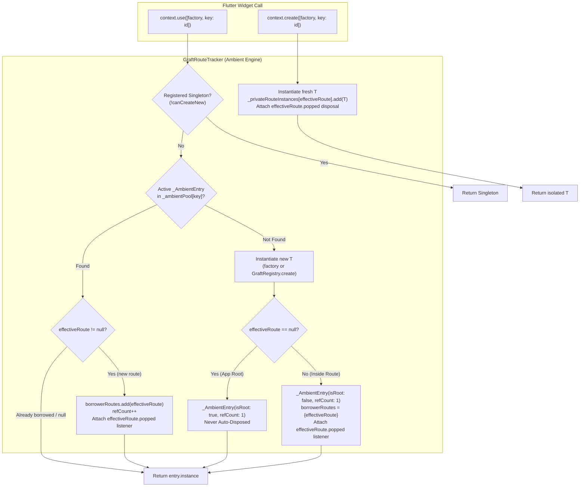

# Master Plan: Zero-Wrapper Architecture (Alpha 6)
## Ref-Counted Ambient Lifecycle Engine, `GraftScope` Elimination & Documentation Rebalancing

---

## 🎯 Executive Summary
The goal of this architectural upgrade for **Alpha 6** is to transform Graft into a **100% Zero-Wrapper State Management Framework**:
1. **Total Elimination of `GraftScope`**: No deprecation shims, no legacy wrappers. Developers never have to wrap widgets, tabs, or screens in scopes or providers.
2. **Ref-Counted Ambient Engine**:
   - `context.use<T>()`: Borrow or create from the Ambient Pool. Automatically promoted to an app-wide permanent singleton when invoked at the App Root (`route == null`). When invoked within screens, tracks borrower routes and auto-disposes when all borrower routes pop (`refCount == 0`).
   - `context.create<T>()`: Forces a fresh, isolated instance owned exclusively by the caller route, bypassing the ambient pool.
3. **Five Automatic Risk Safeguards**:
   - **Rebuild Idempotency**: Set-based route tracking prevents `refCount` inflation across widget rebuilds.
   - **Entity/Screen Recursion**: Keyed ambient resolution (`key: id`) for detail-to-detail navigation.
   - **Navigator Branch Ancestry**: Automatic isolation between parallel tab navigators.
   - **Non-Linear Navigation Safety**: Multi-route ref-counting protects controllers during `pushReplacement`.
   - **Tombstone-Deferred Teardown**: Eliminates crashes during 300ms exit transition animations.
4. **Performance Boost**:
   - Lookup speed improves from $\mathcal{O}(\text{depth} + \text{stack})$ to $\mathcal{O}(1)$.
   - Teardown improves from $\mathcal{O}(N)$ linear scan to $\mathcal{O}(1)$ set removal.
   - Zero wrapper widgets = fewer element tree allocations and less GC pressure.
5. **Documentation Restructuring & Rebalancing**:
   - **`README.md`**: Simplified and kept developer-friendly. Deep architectural internal details are offloaded to `ARCHITECTURE.md`, leaving `README.md` with a clean Quick Start, concise feature summaries, and cheat sheet.
   - **`ARCHITECTURE.md`**: Expanded into the **Definitive Deep-Dive Reference** containing the complete mechanical and algorithmic architecture (SIMD diffing, slot engine, TypeId arrays, reverse DAG, dry persistence, and the new Ref-Counted Ambient Engine).

---

## 🏗️ Architecture & Data Structures



### 1. Data Structures (`lib/src/route/graft_route_tracker.dart`)

```dart
/// Unique key for ambient pool lookups, supporting optional family/tag keys.
@immutable
class _AmbientKey {
  final Type type;
  final Object? key;

  const _AmbientKey(this.type, [this.key]);

  @override
  bool operator ==(Object other) =>
      identical(this, other) ||
      other is _AmbientKey &&
          runtimeType == other.runtimeType &&
          type == other.type &&
          key == other.key;

  @override
  int get hashCode => Object.hash(type, key);

  @override
  String toString() => key == null ? '$type' : '$type(key: $key)';
}

/// Ref-counted lifecycle container for an ambient Graft instance.
class _AmbientEntry<T extends Graft> {
  final T instance;
  int refCount;
  final bool isRoot;
  final Set<Route<dynamic>> borrowerRoutes;

  _AmbientEntry({
    required this.instance,
    this.refCount = 1,
    this.isRoot = false,
  }) : borrowerRoutes = <Route<dynamic>>{};
}
```

### 2. Ambient Storage in `GraftRouteTracker`
```dart
class GraftRouteTracker {
  // Ambient Pool: maps _AmbientKey -> _AmbientEntry
  static final Map<_AmbientKey, _AmbientEntry<dynamic>> _ambientPool = {};

  // Route-Private Instances (context.create): maps Route -> List<Graft>
  static final Map<Route<dynamic>, List<Graft>> _privateRouteInstances = {};

  // Active Navigator Route Stack
  static final List<Route<dynamic>> _routeStack = [];

  // Exit animation tombstones
  static final Map<Route<dynamic>, Map<Type, Graft>> _tombstones = {};
}
```

---

## ⚙️ Algorithmic Flows

### 1. `context.use<T>([factory, {Object? key}])`
1. **Global Singleton Check**:
   If `!GraftRegistry.canCreateNew<T>()`, return `GraftRegistry.getOrCreateSingleton<T>()`.
2. **Key Construction**:
   `final ambientKey = _AmbientKey(T, key);`
3. **Route Resolution**:
   `final rawRoute = ModalRoute.of(this) ?? GraftRouteTracker.currentRoute;`
   `final effectiveRoute = rawRoute != null ? GraftRouteTracker.resolveOwnerRoute(rawRoute) : null;`
4. **Ambient Pool Lookup**:
   - If an active `entry` exists in `_ambientPool[ambientKey]`:
     - If `effectiveRoute != null`:
       - If `entry.borrowerRoutes.add(effectiveRoute)` returns `true` (route wasn't already registered):
         - `entry.refCount++`
         - Attach disposal listener:
           ```dart
           effectiveRoute.popped.then((_) => GraftRouteTracker.releaseAmbientBorrower<T>(effectiveRoute, key: key));
           ```
     - Return `entry.instance as T`.
5. **Tombstone Check (Exit-Frame Guard)**:
   If `effectiveRoute != null && GraftRouteTracker.isRouteTombstoned(effectiveRoute)`:
   Create ghost, dispose, and return ghost to prevent resurrecting dead instances during pop frames.
6. **Creation when Absent**:
   `final newInstance = factory != null ? factory() : GraftRegistry.create<T>();`
   - If `effectiveRoute == null`:
     - **App Root Promotion**:
       `_ambientPool[ambientKey] = _AmbientEntry<T>(instance: newInstance, refCount: 1, isRoot: true);`
   - If `effectiveRoute != null`:
     - **Route-Scoped Ambient**:
       `final entry = _AmbientEntry<T>(instance: newInstance, refCount: 1, isRoot: false);`
       `entry.borrowerRoutes.add(effectiveRoute);`
       `_ambientPool[ambientKey] = entry;`
       `effectiveRoute.popped.then((_) => GraftRouteTracker.releaseAmbientBorrower<T>(effectiveRoute, key: key));`
7. Return `newInstance`.

---

### 2. Teardown / Auto-Disposal (`releaseAmbientBorrower`)
When `effectiveRoute.popped` fires or `didPop`/`didRemove` executes:
1. `final entry = _ambientPool[_AmbientKey(T, key)];`
2. If `entry == null` return;
3. If `entry.borrowerRoutes.remove(effectiveRoute)`:
   - `entry.refCount--;`
   - If `entry.refCount <= 0 && !entry.isRoot`:
     - Remove from `_ambientPool`.
     - Mark in `_tombstones[effectiveRoute]`.
     - Schedule physical `entry.instance.dispose()` on post-frame/pop completion so exit animations don't crash.

---

### 3. `context.create<T>([factory, {Object? key}])`
1. **Global Singleton Check**: If `!GraftRegistry.canCreateNew<T>()`, return singleton.
2. **Instantiate Fresh**: `final newInstance = factory != null ? factory() : GraftRegistry.create<T>();`
3. **Private Route Anchoring**:
   - `final rawRoute = ModalRoute.of(this) ?? GraftRouteTracker.currentRoute;`
   - `final effectiveRoute = rawRoute != null ? GraftRouteTracker.resolveOwnerRoute(rawRoute) : null;`
   - If `effectiveRoute != null`:
     - `_privateRouteInstances.putIfAbsent(effectiveRoute, () => []).add(newInstance);`
     - `effectiveRoute.popped.then((_) { if (!newInstance.isDisposed) newInstance.dispose(); });`
4. Return `newInstance` (completely isolated from ambient pool).

---

## 🛡️ Automatic Safeguards Matrix

| Risk Scenario | Naive Global Pool Flaw | Alpha 6 Automatic Engine Solution |
| :--- | :--- | :--- |
| **Widget Rebuilds** (`setState` / Animation ticks) | `refCount` increments on every build, never drops to 0, leaks forever. | `Set.add(effectiveRoute)` returns `true` only on the first call. Rebuilds are **100% idempotent**. |
| **Details ➔ Related Details** (`Product(1)` ➔ `Product(2)`) | Screen 2 borrows Screen 1's state, showing wrong data. | Keyed ambient support: `key: productId`. Differentiates ambient entries automatically. |
| **Push-Replacement Navigation** | Popping predecessor route immediately disposes controller, crashing successor. | Controller is ref-counted across **all active borrower routes**. Stays alive until last borrower pops. |
| **300ms Exit Animations** | Synchronous disposal on pop causes widgets animating out to read disposed state. | Tombstone deferred teardown guarantees safe reads during transition frames. |
| **Parallel Navigators (Tabs)** | Independent tabs accidentally share local non-root controllers. | Navigator branch ancestry validation scopes non-root ambient instances to matching navigator branches. |

---

## 📚 Documentation Rebalancing & Architecture Offload

Currently, `README.md` is bloated with over 1,100 lines containing deep internal architectural details (SIMD bitmask diffing registers, Element pointer internals, TypeId monotonic array layout, DAG topological sorting, etc.), while `ARCHITECTURE.md` only has 107 lines of high-level summaries.

For Alpha 6, we will rebalance both files:

```
┌───────────────────────────────────────────────┐     ┌───────────────────────────────────────────────┐
│                   README.md                   │     │                ARCHITECTURE.md                │
│             (Clean, Fast, Usable)             │     │         (Exhaustive Deep Dive Hub)            │
├───────────────────────────────────────────────┤     ├───────────────────────────────────────────────┤
│ • Quick Start & 3 Core Concepts               │     │ • Complete 6 Pillars Deep Dive:               │
│ • Zero-Wrapper DX: context.use vs create      │     │   - 64-bit SIMD Word Diff Engine              │
│ • Clean Public API Cheat Sheet                │ ──> │   - Surgical Leaf Element Pointer Pipeline    │
│ • Benchmark Summary Scorecard                 │     │   - TypeId Monotonic Array Layout & Cache Hits│
│ • High-level summary of architecture          │     │   - In-degree Topological Reverse DAG Teardown│
│ • Clear links pointing to ARCHITECTURE.md     │     │   - Async Gate Frame-0 Lock Mechanism         │
│   for deep-dive engineering details           │     │   - Synchronous Frame-0 Dry L1 RAM Engine     │
│                                               │     │ • Ref-Counted Ambient Engine Mechanics:       │
│                                               │     │   - Ambient Pool vs Route Private Stacks      │
│                                               │     │   - Rebuild Idempotency & Branch Isolation    │
│                                               │     │   - Full Mermaid Sequence & State Diagrams   │
└───────────────────────────────────────────────┘     └───────────────────────────────────────────────┘
```

### Specific Deliverables:
1. **`ARCHITECTURE.md` (Expanded into the Definitive Reference)**:
   - Move deep technical descriptions from `README.md` Section 9 ("High-Performance Architecture") into `ARCHITECTURE.md`.
   - Add detailed sections for:
     - Hardware-aligned bitmask diffing with 64-bit integer words (`GraftMask`).
     - Leaf slot isolation (`ChildSlotEngine`, `GraftFastReceiver`, C-level Element pointer dispatch).
     - Monotonic `TypeId` array lookup ($\le 12\text{ ns}$ cold, $< 0.8\text{ ns}$ hot).
     - Reverse DAG topological sort & cycle detection.
     - Frame-0 Dry State & Coalescing Background Persistence (L1 RAM cache, 300ms debounce queue, schema fingerprinting).
     - **NEW Pillar 7**: Ref-Counted Ambient Lifecycle Engine (Zero-Wrapper, `_AmbientEntry`, `borrowerRoutes` Set idempotency, `isRoot` root auto-promotion, tombstone deferred unmount).
2. **`README.md` (Trimmed & Polished)**:
   - Keep it lightweight, readable, and developer-friendly.
   - Remove dense low-level engine details and replace them with clear summaries and markdown links to `ARCHITECTURE.md`.
   - Remove all mentions and examples of `GraftScope`.
   - Showcase the 2 universal verbs: `context.use<T>()` vs `context.create<T>()`.
   - Provide a clean, practical public API cheat sheet.

---

## 📋 Step-by-Step Implementation Checklist

### Phase 1: Code Deletion & Cleanup (No Deprecations — Alpha 6)
- [ ] Delete `lib/src/widgets/graft_scope.dart`.
- [ ] Remove `export 'src/widgets/graft_scope.dart' show GraftScope;` from `lib/graft.dart`.
- [ ] Remove `GraftScope` wrapper in `example/lib/main.dart` (`EnterpriseDIScreen` directly returns `Scaffold`).
- [ ] Remove obsolete `GraftScope` test from `test/graft_v1_features_test.dart`.

### Phase 2: Engine Implementation
- [ ] In `lib/src/route/graft_route_tracker.dart`:
  - Define `_AmbientKey` and `_AmbientEntry<T>`.
  - Add `_ambientPool` and `_privateRouteInstances`.
  - Implement `getAmbient<T>`, `borrowAmbient<T>`, `registerAmbientRoot<T>`, `registerAmbientRoute<T>`, `releaseAmbientBorrower<T>`, and `registerPrivate<T>`.
  - Update `didPop`, `didRemove`, `didReplace`, and `reset()` to clean up both ambient and private instances.
- [ ] In `lib/src/context/graft_context.dart`:
  - Update `context.use<T>([factory, key])` with the borrow-or-create ambient flow.
  - Update `context.create<T>([factory, key])` with the isolated private flow.
  - Update `use2`, `use3`, and `use4`.
  - Remove all `GraftScope` lookups and references.

### Phase 3: Exhaustive Test Suite (`test/ambient_engine_test.dart`)
- [ ] **Test 1: App-Root Ambient Auto-Promotion**:
  - Call `context.use(ThemeGraft.new)` above `Navigator` (`route == null`).
  - Push `/settings` screen calling `context.use(ThemeGraft.new)`.
  - Verify `identical(settingsGraft, rootGraft)`.
  - Pop `/settings` -> verify `ThemeGraft` remains alive and NOT disposed (`isRoot: true`).
- [ ] **Test 2: Multi-Route Ref-Count Teardown**:
  - Screen 1 calls `context.use(FlowGraft.new)` (`refCount = 1`).
  - Screen 2 calls `context.use(FlowGraft.new)` (`refCount = 2`).
  - Screen 3 calls `context.use(FlowGraft.new)` (`refCount = 3`).
  - Pop Screen 3 -> assert `flowGraft.isDisposed == false` (`refCount = 2`).
  - Pop Screen 2 -> assert `flowGraft.isDisposed == false` (`refCount = 1`).
  - Pop Screen 1 -> assert `flowGraft.isDisposed == true` and pool is clean (`refCount = 0`).
- [ ] **Test 3: Re-entrant Rebuild Idempotency**:
  - Trigger 50 rebuilds on Screen 1; assert `refCount` remains 1 and single pop disposes cleanly.
- [ ] **Test 4: `context.create` Isolation**:
  - Active ambient `ItemGraft` present; call `context.create(ItemGraft.new)`.
  - Assert `!identical(created, ambient)`.
  - Popping screen disposes `created` without affecting `ambient`.
- [ ] **Test 5: Push-Replacement Survival**:
  - Screen 1 creates ambient Graft; pushes Screen 2 with `pushReplacement`.
  - Screen 1 pops; assert Graft stays alive for Screen 2.
- [ ] **Test 6: Keyed Ambient Resolution**:
  - Call `context.use(() => ItemGraft(1), key: 1)` and `context.use(() => ItemGraft(2), key: 2)`.
  - Assert both coexist independently in ambient pool.
- [ ] **Test 7: Frame-0 Dry Persistence Integration**:
  - Pre-warm L1 persistence cache; instantiate dry state at App Root (`route == null`).
  - Assert synchronous Frame-0 hydration and `isRoot: true`.

### Phase 4: Documentation Overhaul & Architectural Restructuring
- [ ] **Restructure `ARCHITECTURE.md`**: Expand into the definitive deep-dive reference containing full technical explanations and diagrams for all 7 architectural pillars (including SIMD bitmask diffing, leaf slot pipeline, monotonic TypeId, reverse DAG, dry persistence, and the Ref-Counted Ambient Engine).
- [ ] **Streamline `README.md`**:
  - Offload heavy architectural internal details to `ARCHITECTURE.md`.
  - Retain short architectural summaries with clear links to `ARCHITECTURE.md`.
  - Remove all mentions of `GraftScope`.
  - Highlight the zero-wrapper paradigm and the 2 universal verbs: `context.use` vs `context.create`.
- [ ] Update `GRAFT_GUIDE.md`, `DI_GUIDE.md`, and `ROUTE.md` to remove `GraftScope` and reflect zero-wrapper patterns.
- [ ] Update `CHANGELOG.md` for Alpha 6.
- [ ] Update `pubspec.yaml` to `1.0.0-alpha.6`.

### Phase 5: Verification Gates
- [ ] `flutter analyze` -> 0 warnings, 0 errors.
- [ ] `flutter test` -> 100% tests passing.
